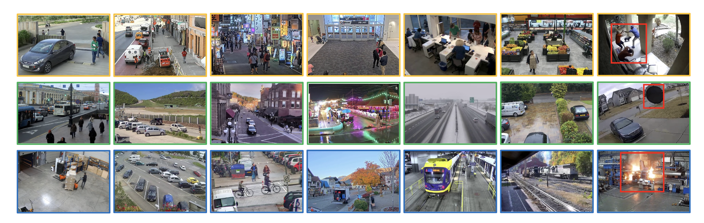

# [NeurIPS 2024] MSAD - A Benchmark for Video Anomaly Detection
[](https://msad-dataset.github.io/)
[](https://arxiv.org/abs/2402.04857)
[](https://github.com/Tom-roujiang/MSAD)
[](https://huggingface.co/datasets/Liyun1009/MSAD)



This is a implementation of our work **"Advancing Video Anomaly Detection: A Concise Review and a New Dataset"** (Accepted by 2024 NeurIPS Dataset and Benchmark Track).  We provide code for benchmarking our new Multi-Scenario Video Anomaly Detection dataset.


We propose a new **Multi-Scenario Anomaly Detection (MSAD) dataset**, a high- resolution, real-world anomaly detection benchmark encompassing diverse scenarios and anomalies, both human and non-human-related. For more details and applying for our MSAD dataset, please refer to our project website: [Project Website](https://msad-dataset.github.io).

## Important Update

**Update (October 13, 2026):** MSAD is now available as a **gated dataset** on [ **Hugging Face**](https://huggingface.co/datasets/Liyun1009/MSAD). Request access directly on the dataset page using your **official institutional email address**.

If you have any questions or encounter difficulties with the application or download process, email [Liyun.Zhu@alumni.anu.edu.au](mailto:Liyun.Zhu@alumni.anu.edu.au) and CC: [time.lab@griffith.edu.au](mailto:time.lab@griffith.edu.au), [l.wang4@griffith.edu.au](mailto:l.wang4@griffith.edu.au).

## Dataset Preparation

For the original videos, follow the Hugging Face access instructions above.

We use this [I3D_Feature_Extraction_resnet](https://github.com/GowthamGottimukkala/I3D_Feature_Extraction_resnet) repo for extracting I3D features. We also offer extracted features (I3D and Video-Swin Transformer) available for all researchers. [(Feature_Download Link)](https://drive.google.com/drive/folders/1mxFGCcAuEecN0c7MHD12wD4pO2Ej5kLe)

**Note that the Dataset is to be used solely for academic and research purposes. Commercial use, reproduction, distribution, or sale of the Dataset or any derivative works is strictly prohibited.**


## Benchmarking on MSAD Dataset

For benchmarking weakly-supervised methods on our MSAD dataset, we follow **Evaluation Protocol ii** as described in our paper. Training and testing file list can be found in [feature_download](https://drive.google.com/drive/folders/1mxFGCcAuEecN0c7MHD12wD4pO2Ej5kLe) link. We have also provide the pretrained checkpoints for several methods in the link. 

We have designed two protocol in our work. This GitHub repo only supports Protocol ii.

**Protocol ii:** Train on 360 normal and 120 abnormal videos, and test on 120 normal and 120 abnormal videos. During training, we only provide video-level annotations. This protocol is suitable for evaluating weakly-supervised methods trained with our video-level annotations. 

If you want to test the model, you can download our pre-trained model from [here](https://drive.google.com/drive/folders/1mxFGCcAuEecN0c7MHD12wD4pO2Ej5kLe). Our MSAD dataset supports benchmarking with the following weakly-supervised methods:

- RTFM
- MGFN
- UR-DMU (TODO)


### RTFM

An example for testing the model is shown below, you can modify arguments for different datasets (e.g. MSAD, UCF-Crime, ShanghaiTech, etc).

```shell
cd RTFM
python test.py --test-rgb-list 'list/msad-i3d-test.list' \
	--gt './list/gt-MSAD-WS-new.npy'   \
    --testing-model './ckpt/rtfm-msad-i3dfinal.pkl' \
    --dataset 'msad' 
```

Here is an example for training the model:

```shell
python main.py --feat-extractor 'i3d'\ 
	--feature-size 2048 --rgb-list 'list/msad-i3d.list' \
	--test-rgb-list 'list/msad-i3d-test.list' --gt default='list/gt-MSAD-WS-new.npy' \
	--dataset 'msad' 2>&1 | tee ./train_logs_i3d_msad.txt
```


### MGFN

```shell
cd MGFN
python test.py --testing-model ./ckpt/mgfn-msad-i3d-84.96.pkl  
```

For training the model, just run the following code:

```shell
cd MGFN
python main.py 
```

You can check the relevant arguments in `option.py` and adjust them accordingly.


## Citation

If you find MSAD useful in your research, please consider citing our paper 📝

```markdown
@inproceedings{msad2024,
    title = {Advancing Video Anomaly Detection: A Concise Review and a New Dataset},
    author = {Liyun Zhu and Lei Wang and Arjun Raj and Tom Gedeon and Chen Chen},
    booktitle = {The Thirty-eight Conference on Neural Information Processing Systems Datasets and Benchmarks Track},
    year = {2024}
} 
```


## Acknowledgement

This codebase is built on top of [RTFM](https://github.com/tianyu0207/RTFM), [MGFN](https://github.com/carolchenyx/MGFN.), [UR-DMU](https://github.com/henrryzh1/UR-DMU), and we thank the authors for their work.
